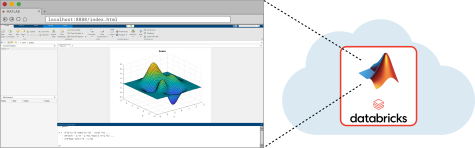

# Run MATLAB on Databricks

This repository shows how to run MATLAB&reg; workflows on Databricks&reg;.

First, your organization's administrator needs to:

- [Set Up MATLAB on Databricks](./guides/admin/set-up-matlab-on-databricks.md)

Then, MATLAB users in your organization can:

- [Run MATLAB Interactively on Databricks](./guides/run-matlab-interactively-on-databricks.md)
  - Access the MATLAB desktop in your web browser, running on a Databricks cluster.

  - Develop and debug algorithms interactively before scaling out.

- [Query Data in Databricks from MATLAB](./guides/query-data-using-database-toolbox.md)
  - Run SQL queries on a Databricks cluster or SQL warehouse using  Database Toolbox&trade;.

- [Scale MATLAB Workflows on Databricks](./guides/scale-matlab-workflows-on-databricks.md)
  - Scale MATLAB code interactively on a single node using Parallel Computing Toolbox&trade;.

  - Perform Spark operations in MATLAB on a single node, for quick development and testing.

  - Combine Spark operations with compiled MATLAB or Simulink&reg; code for quick development in MATLAB, across multiple nodes.

  - Scale production workflows with compiled MATLAB or Simulink code for frequent and complex computations, across multiple nodes.

## Contact Support

To request technical support or submit an enhancement request, [create a GitHub issue](https://github.com/mathworks-ref-arch/matlab-on-databricks/issues) or contact [databricks@mathworks.com](mailto:databricks@mathworks.com).

---------------

Copyright 2026 The MathWorks, Inc.
