# Configure Network License Manager for Databricks

This guide shows administrators how to configure a Network License Manager for running MATLAB on Databricks.

If your organization uses a Network License Manager (NLM), your users' Databricks clusters must be able to reach the license server to validate licenses.

How this connection is established depends on where the Network License Manager is hosted. If the Network License Manager is hosted in a private or on-premises environment, you need to configure appropriate network access, such as firewall rules, routing, or tunneling, to allow the Databricks cluster to communicate with the NLM.

This guide addresses the scenario where both Databricks and the Network License Manager are running in separate, isolated private networks on the same cloud provider (Azure VNet or AWS VPC). In this setup, the two networks have no route to each other by default, and MathWorks recommends you establish a **VNet/VPC peering connection** along with the necessary routes and firewall rules to allow MATLAB sessions to reach the license server privately and securely.

## Requirements

- A Network License Manager for MATLAB running on the same Cloud provider as your Databricks Workspace. If you need to create a Network License Manager, use the appropriate reference architecture for your cloud provider:
  - [Network License Manager for MATLAB (Azure)](https://github.com/mathworks-ref-arch/license-manager-for-matlab-on-azure-linux)
  - [Network License Manager for MATLAB (AWS)](https://github.com/mathworks-ref-arch/license-manager-for-matlab-on-aws)
- Necessary privileges to manage the networking permissions in your Databricks Workspace and your cloud environment.

## Select a Cloud Provider for Instructions

- [Configure VNet Peering between Databricks and License Manager for Azure](#configure-vnet-peering-between-databricks-and-license-manager-for-azure)
- [Configure VPC Peering between Databricks and License Manager for AWS](#configure-vpc-peering-between-databricks-and-license-manager-for-aws)

### Configure VNet Peering between Databricks and License Manager for Azure

#### Peering from Databricks Service to License Manager

1. Navigate to the Databricks Service in Azure Portal.
2. On the left sidebar, click **Settings**.
3. Click **Virtual Network Peerings**.
4. Click **Add Peering**.

   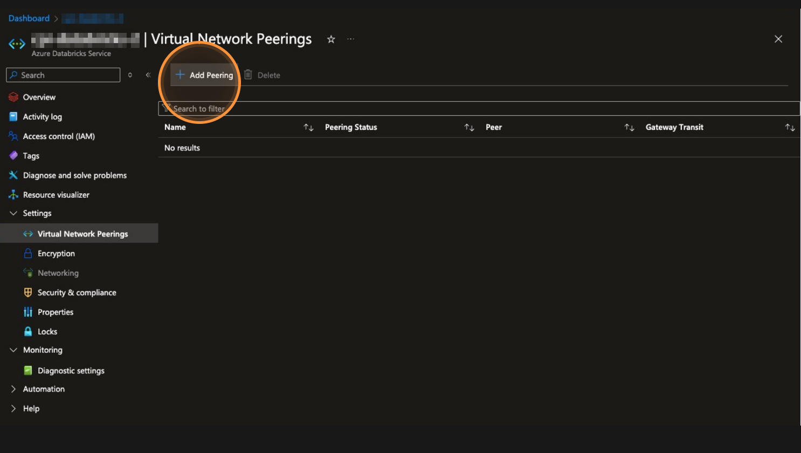

5. Provide the following information:
   - Specify the **peering link name**. You use `NLMVNETPEERING` in this example.
   - Select the **Virtual Network** to peer with. You use `netlm-vnet` in this example.
   - Select the checkboxes to **Allow virtual network access** and **Allow forwarded traffic**.
   - Copy the **Databricks Service Resource ID** for using this value in the next steps. You use `/subscriptions/1234567890` in this example.

   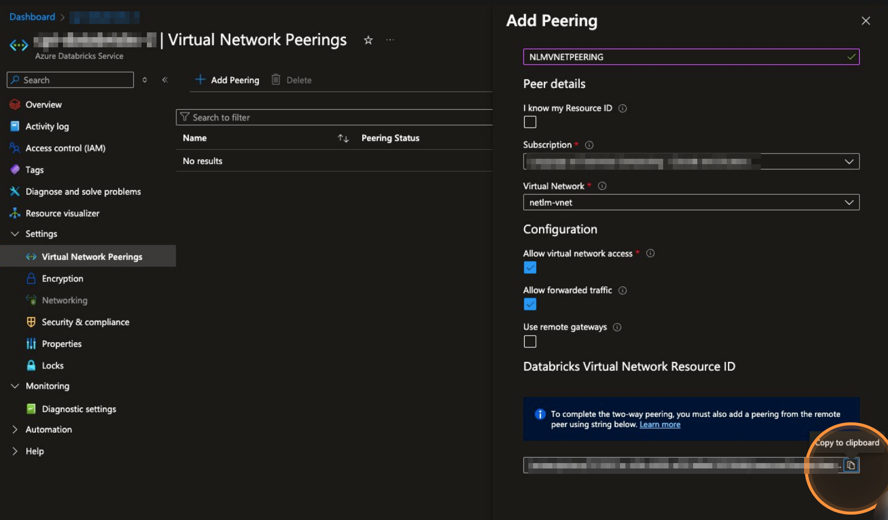

#### Peering from License Manager to Databricks Service

Now you need to establish a peering connection from the peer virtual network to the Databricks virtual network using the **Databricks Service Resource ID** you copied in the previous step.

1. Navigate to your peer virtual network in Azure Portal. This example uses `netlm-vnet`.
2. On the left sidebar, click **Peerings**.
3. Click **Add**.

   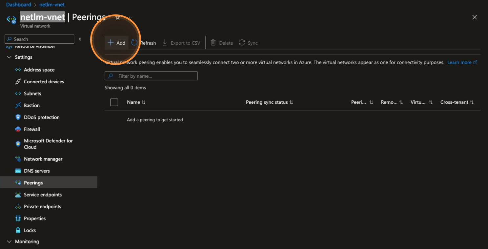

4. Provide the following information:
   - Specify the **peering link name**. You use `DBPeeringLinkName` in this example.
   - Select the check box **I know my resource ID**.
   - Paste the **Databricks Service Resource ID** from the previous step into the **Resource ID** field. You use `/subscriptions/1234567890` in this example.
   - Ensure the check boxes to **Allow 'workers-vnet' to access 'netlm-vnet'** and **Allow 'workers-vnet' to receive forwarded traffic from 'netlm-vnet'** are checked.
   - Speciy a **Local peering link name** You use `LocalPeeringLinkName` in this example.
   - Ensure the check box to **Allow 'netlm-vnet' to access 'workers-vnet'** and **Allow 'netlm-vnet' to receive forwarded traffic from 'workers-vnet'** is selected.

    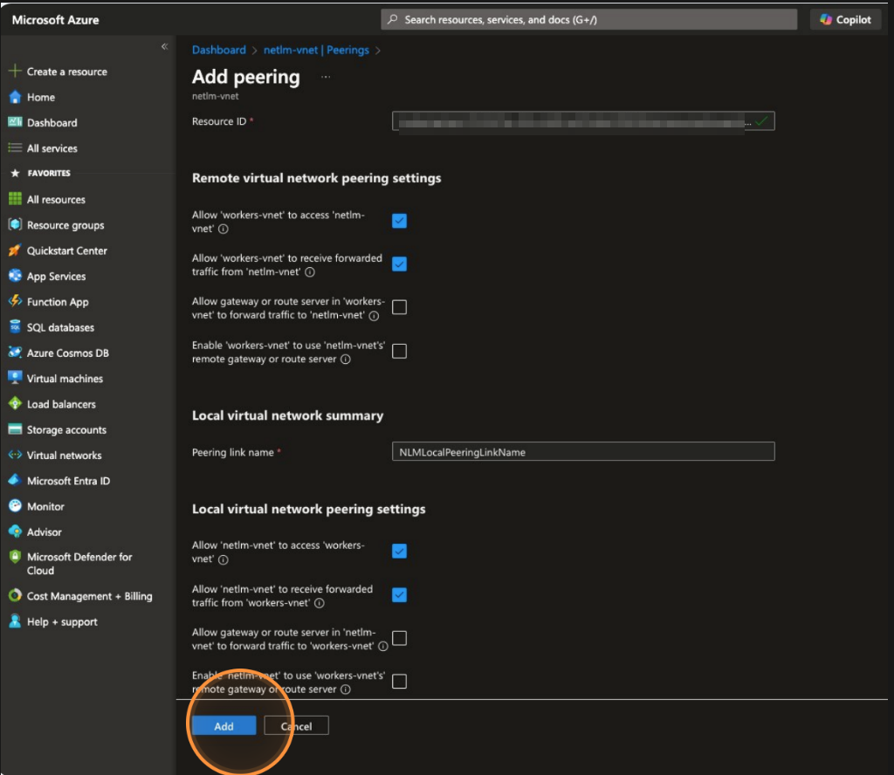

5. Click **Add**.

    

6. When the peering connection is established, you should be able to access the MATLAB license server in the peer virtual network from your Databricks Workspace.

#### Test the VNET Peering Status on Databricks Service

1. Navigate to the Databricks Service in your cloud provider.
2. On the left sidebar, click **Settings**.
3. Click **Virtual Network Peerings**.
4. The Status of the VNET Peering `NLMVNETPEERING` should now be **Connected**.

    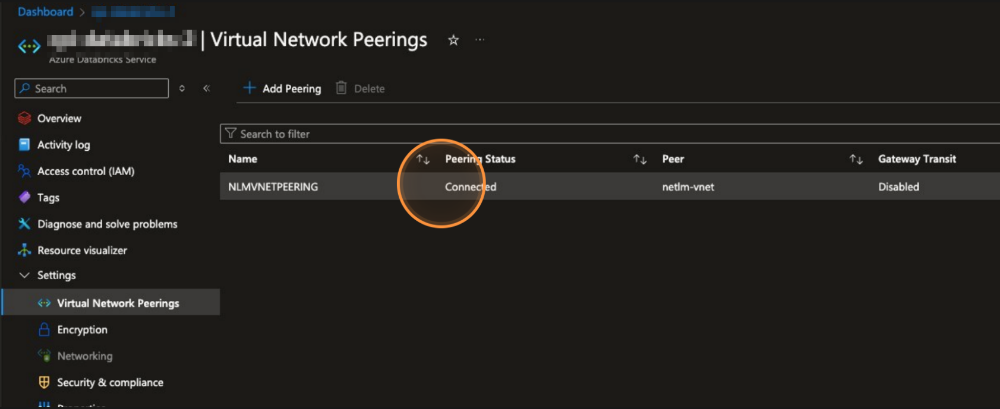

#### Test the VNET Peering Status on MATLAB License Manager

1. Navigate to your peer virtual network in Azure Portal, which is `netlm-vnet` in this example.
2. On the left sidebar, click **Peerings**.
3. The Status of the VNET Peering `DBPeeringLinkName` should now be **Connected**.

#### Get the Hostname of the NLM server

1. Go to your Virtual Network in your cloud provider. You use `netlm-vnet` in this example.
2. On the left sidebar, click **Overview**.
3. Click the **Resource group** link to navigate to the Resource group, which is `nlm4databricks` in this example.

    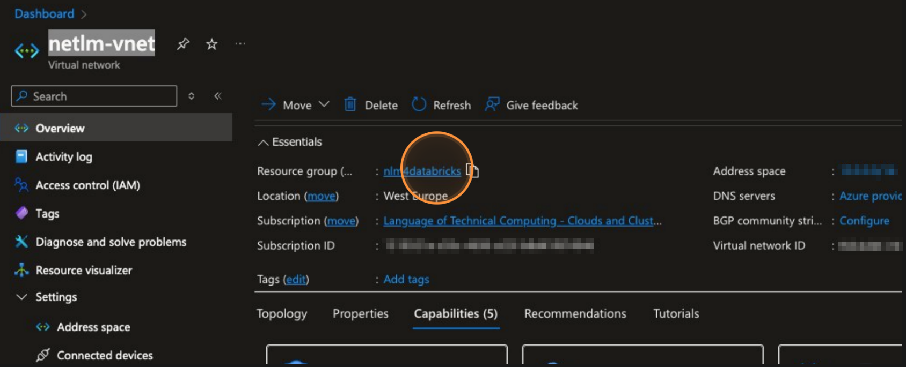

4. Click the **Virtual Machine** where the NLM server is running, which is `netlm-server` in this example. This opens the **Overview** page for the Virtual Machine.
5. Copy the **Private IP Address** of the Virtual Machine. This is the hostname of the NLM server.

    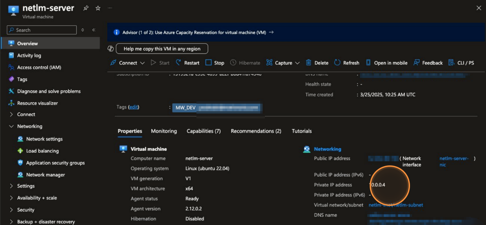

#### Specify License Manager Address for MATLAB

To allow MATLAB to connect to the network license manager, provide the `port@hostname` value to MATLAB in these ways:

- you can specify the value as the `LICENSE_SERVER` argument in the Dockerfile. For instructions, see [Set Up MATLAB Desktop on Datarbricks: Build Docker Image](./set-up-matlab-on-databricks.md#build-the-docker-image).

- you can specify the value as the environment variable `spark_env_vars.MLM_LICENSE_FILE` in the cluster policy you create for users. For instructions, see [Create Cluster Policy: NLM Server Address](./create-cluster-policy-for-matlab-on-databricks.md#nlm-server-address).

- if you do not do either of the above, your users will see a prompt to enter their license details when they start MATLAB. For details, see [Run MATLAB Interactively on Databricks](../run-matlab-interactively-on-databricks.md#start-a-matlab-session). This method is slower because MATLAB will not start until your users enter their license address.

### Configure VPC Peering between Databricks and License Manager for AWS

On AWS, Databricks runs in a VPC. To allow your clusters to reach the MATLAB Network License Manager (NLM) in another VPC, you set up VPC peering and add routes and security group rules. The NLM VPC must use a CIDR range that does **not** overlap with the Databricks VPC (or any CIDR already in the Databricks VPC main route table).

Consult your AWS or DevOps team before making changes. You need sufficient permissions and familiarity with the VPC dashboard to avoid impacting existing infrastructure. For details, see the [Databricks VPC peering guide (Databricks)](https://docs.databricks.com/aws/en/security/network/classic/vpc-peering) and the [AWS VPC Peering guide (Databricks)](https://docs.aws.amazon.com/vpc/latest/userguide/vpc-peering.html).

Before you start, record:

- **Databricks VPC**: ID and CIDR range (e.g. `vpc-db`, `10.126.0.0/16`).
- **NLM VPC**: ID and CIDR range (e.g. `vpc-nlm`, `172.31.0.0/16`).
- **Databricks VPC main route table** ID (e.g. `rtb-db`).

You can find the Databricks VPC in the AWS Console by opening the VPC dashboard and identifying the VPC used by your Databricks workspace (by name or tags, or from your workspace setup notes).

#### Create the VPC peering connection (Databricks → NLM)

1. In the AWS Console, open the **VPC** service and go to **Peering Connections**.
2. Click **Create peering connection**.
3. Set **VPC (Requester)** to the **Databricks VPC** ID.
4. Choose **Another account** or **My account** depending on where the NLM VPC lives:
   - **My account**: Select the **NLM VPC** from the dropdown.
   - **Another account**: Enter the AWS account ID that owns the NLM VPC and the NLM VPC ID.
5. Set **VPC (Accepter)** to the **NLM VPC** ID.
6. Optionally add a name (e.g. `Databricks-to-NLM`) and description.
7. Click **Create peering connection**.

   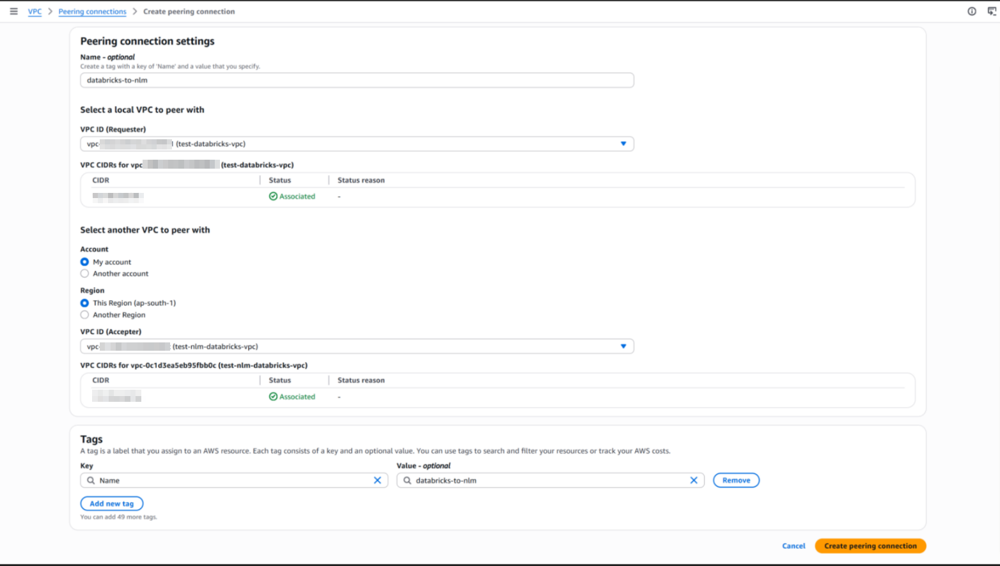

8. Note the **Peering connection ID** (e.g. `pcx-1234`). You will use it for route tables and for accepting the request.

   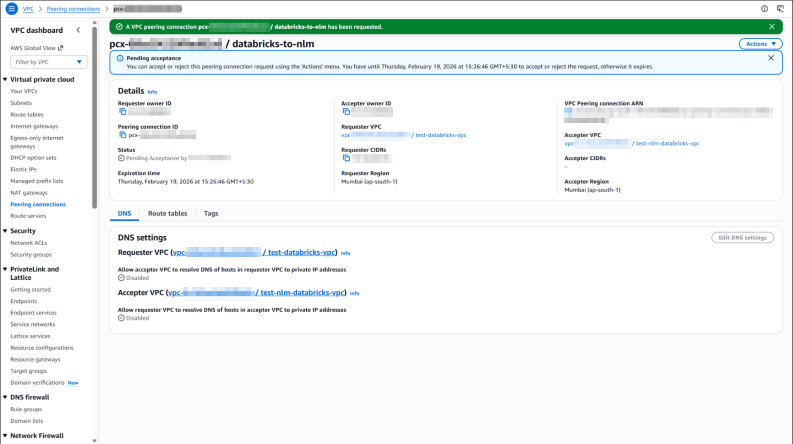

#### Accept the peering connection (NLM VPC side)

The owner of the NLM VPC must accept the peering request.

1. In the AWS account that owns the NLM VPC, open **VPC > Peering Connections**.
2. Find the peering connection. Its status will be **Pending acceptance**.
3. Select the peering connection, then **Actions** → **Accept request**.

   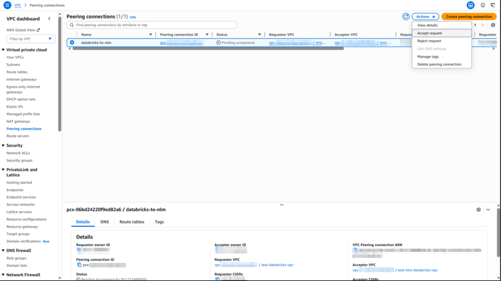

4. Check details of the peering connection and click **Accept request**.

   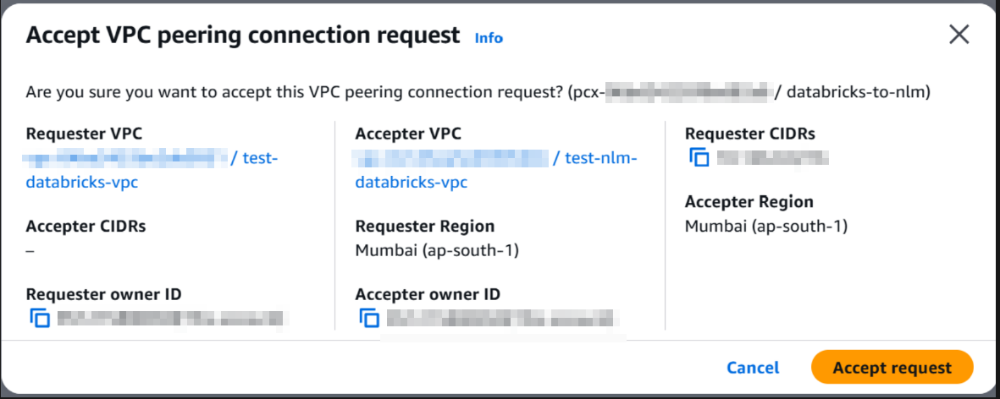

5. Confirm. After acceptance, the status becomes **Active**.

   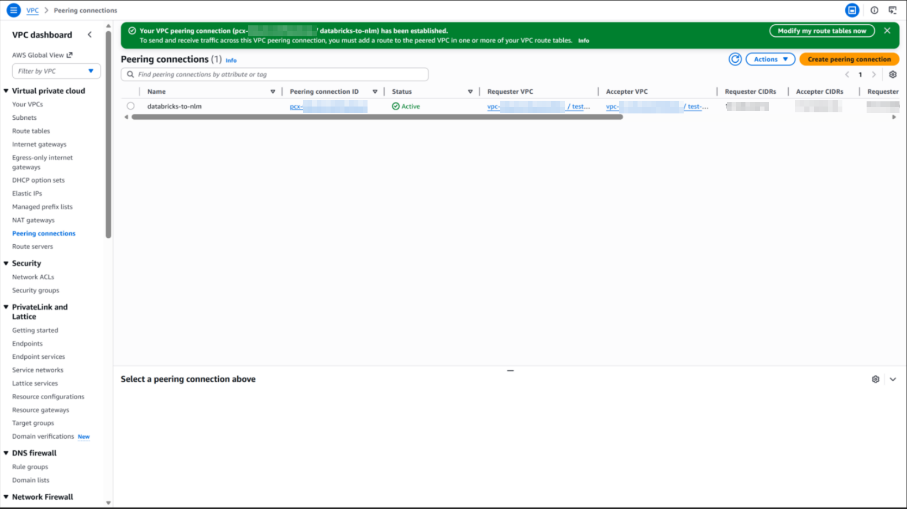

If the NLM VPC is in the same account as the Databricks VPC, you can accept in the same console session.

#### Add Routes to Allow Traffic to Reach Both VPCs

**In the Databricks VPC:**

1. Go to **VPC > Route tables**.
2. Locate the **main route table** (e.g. `rtb-db`) for the Databricks VPC (filter by the Databricks VPC ID if needed).
3. Select it, open the **Routes** tab, and click **Edit routes**.
4. **Add route**: **Destination** = CIDR of the NLM VPC (e.g. `172.78.0.0/16`), **Target** = **Peering connection**, then select the peering connection ID.

    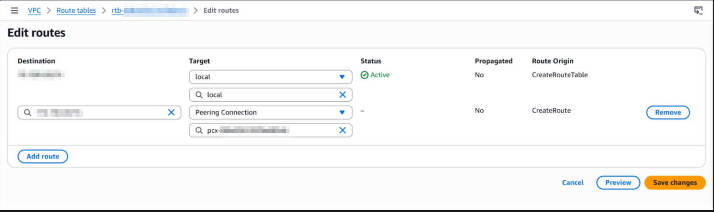

5. Save.

Note: Make sure to modify the route tables which are connected to the subnets in which the Databricks clusters are running.

**In the NLM VPC:**

1. Go to **VPC > Route tables**.
2. Locate the **main route table** for the NLM VPC.
3. Select it, open the **Routes** tab, and click **Edit routes**.
4. **Add route**: **Destination** = CIDR of the Databricks VPC (e.g. `10.126.0.0/16`), **Target** = **Peering connection**, then select the same peering connection ID.

    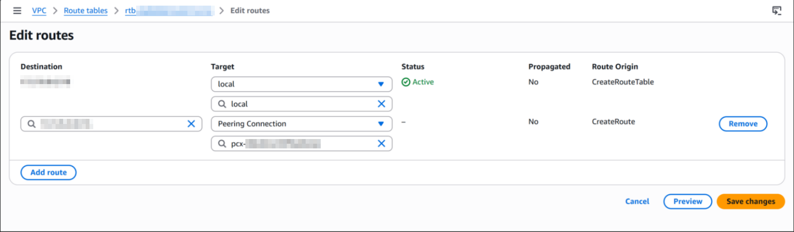

5. Save.

Note: Make sure that the route table is connected to the subnet in which the NLM server is running.

#### Allow NLM Traffic from Databricks (Security Groups)

Databricks clusters use an **unmanaged** security group in the Databricks VPC. The NLM host must allow inbound traffic from that group on the license manager port (default **27000**)..

1. **Find the Databricks unmanaged security group**
   - Navigate to **VPC > Security groups**.
   - Filter by the Databricks VPC ID.
   - If the workspace uses a Databricks-managed VPC, find the security group whose name includes **Unmanaged** and note its ID (e.g. `sg-96016bef`). Do **not** use the "Managed" security group.

2. **Allow inbound traffic on the NLM host**
   - In **VPC > Security groups**, open the security group attached to the EC2 instance running the NLM (in the NLM VPC).
   - Click **Edit inbound rules > Add rule**:
     - Specify **Type**: Custom TCP.
     - Specify **Port range**: `27000-27010` (default for MATLAB Network License Manager).
     - Specify **Source**: the Databricks **unmanaged** (or cluster) security group ID from step 1 (you can also use the CIDR of the Databricks VPC, e.g. `10.126.0.0/16`).
   - Save.

For more information about VPC peering in AWS, see [Setting up VPC peering in AWS (Databricks)](https://docs.databricks.com/aws/en/security/network/classic/vpc-peering).

Now the Databricks VPC can reach the NLM over the peering connection, and the NLM can respond.

#### Get the Hostname of the NLM Server

Use the NLM host's **private** IP so traffic stays on the VPC peering path.

1. In the AWS Console, go to **EC2 > Instances**.
2. Select the instance where the MATLAB Network License Manager is running (in the NLM VPC).
3. In the **Details** tab, copy **Private IPv4 address** (e.g. `172.78.1.50`). This is the `hostname` you will use in `port@hostname` (e.g. `27000@172.78.1.50`).

#### Specify License Manager Address for MATLAB

To allow MATLAB to connect to the network license manager, provide the `port@hostname` value to MATLAB in these ways:

- you can specify the value as the `LICENSE_SERVER` argument in the Dockerfile. For instructions, see [Set Up MATLAB Desktop on Databricks: Build Docker Image](./set-up-matlab-on-databricks.md#build-the-docker-image).

- you can specify the value as the environment variable `spark_env_vars.MLM_LICENSE_FILE` in the cluster policy you create for users. For instructions, see [Create Cluster Policy: NLM Server Address](./create-cluster-policy-for-matlab-on-databricks.md#nlm-server-address).

- if you do not do either of the above, your users will see a prompt to enter their license details when they start MATLAB. For details, see [Run MATLAB Interactively on Databricks: Start a MATLAB Session](../run-matlab-interactively-on-databricks.md#start-a-matlab-session). This method is slower because MATLAB will not start until your users enter their license address.
