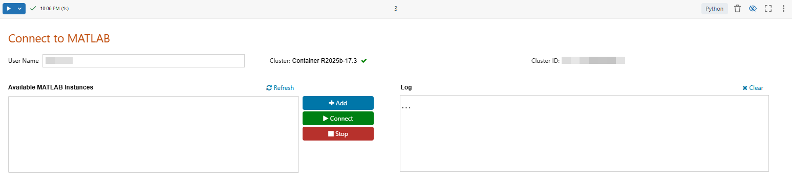
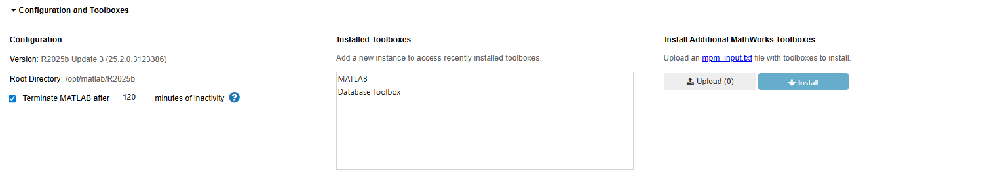
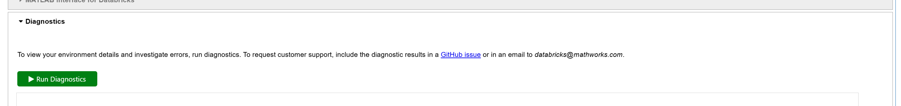
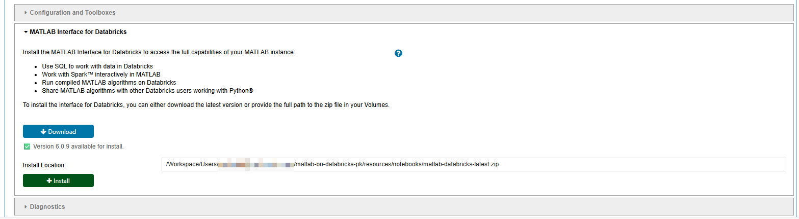

# Run MATLAB Interactively on Databricks

This guide shows how to run the MATLAB&reg; desktop on Databricks&reg;.

## Requirements

- Ensure that your administrator has followed the instructions to [Set Up MATLAB on Databricks (GitHub)](./admin/set-up-matlab-on-databricks.md).

- Follow the instructions to [Import this Repository into Databricks (GitHub)](./import-repository-into-databricks.md).

## Step 1: Create Cluster

Create the cluster where you want to run MATLAB. MATLAB is unable to run on serverless clusters, so you must create a classic compute cluster:

1. Log in to your Databricks Workspace.
2. Navigate to **Compute** and click **Create compute**.
3. Under **General** > **Policy**, select the MATLAB policy that your administrator should have set up for you.
4. Click **Create**.

## Step 2: Start MATLAB

To start MATLAB, follow these steps:

1. In your Databricks workspace, navigate to the folder where you imported this repository. Open **resources > notebooks > Connect_to_MATLAB.ipynb**.
2. From the notebook toolbar, use the [Compute Selector (Databricks)](https://docs.databricks.com/aws/en/notebooks/basic-editing#notebook-toolbar-icons-and-buttons) to select the cluster you set up earlier.
3. Run the code cell.
4. You see the **Connect to MATLAB** user interface in your notebook:

### Start a MATLAB Session

- To start MATLAB, click **Add**. A new MATLAB session starts on the cluster's driver node. A link appears in the log window. Click **Open MATLAB** to open the MATLAB session in a new browser tab.

  If you start multiple MATLAB sessions, these will run on the same node.
  
  If you restart your notebook session or detach your notebook from the cluster, your MATLAB session will shut down.
  
  **Licensing**: Your administrator might have already specified your license details in the Dockerfile or compute policy they used in the workflow [Set Up MATLAB on Databricks](./admin/set-up-matlab-on-databricks.md). Otherwise, on your first login to MATLAB you will be prompted to enter your license details. For assistance, contact your administrator.

- To connect to an existing MATLAB instance, select it from the **Available MATLAB Instances** window, then click **Connect**.

- To stop a running MATLAB instance, select it and click **Stop**.

### Install Additional Toolboxes

Your administrator might have installed certain MATLAB toolboxes when they set up MATLAB for you. To see which toolboxes they installed, run `ver` in MATLAB.

If you want to use additional toolboxes but do not have internet access, contact your administrator and request them to add the required toolboxes to the Docker image they used to [Set Up MATLAB on Databricks](./admin/set-up-matlab-on-databricks.md#build-the-docker-image).

If you do have internet access, you can install the toolboxes yourself:

1. Download the `mpm_input.txt` file that corresponds to your MATLAB release from [MPM Input Files (GitHub)](https://github.com/mathworks-ref-arch/matlab-dockerfile/tree/main/mpm-input-files). In the downloaded file, under the `Products` section, uncomment the lines for the toolboxes you want to install. Save the file.

2. Expand the **Configuration and Toolboxes** section in the notebook. Under **Install Additional MathWorks Toolboxes**, click **Upload** to select and upload your `mpm_input.txt` file from the previous step.

3. When the file validation is complete, click **Install**  to install the toolboxes. Progress is displayed in the log window.

4. Start a new MATLAB session to access the new toolboxes.

#### Run Diagnostics

To investigate errors and view details of your environment, run diagnostics. Expand the **Diagnostics** section in the notebook, and click **Run Diagnostics**.

## Step 3: Install MATLAB Interface for Databricks Package

To run workflows for using Spark, or scaling MATLAB code in Databricks, you need to install a package called the MATLAB Interface for Databricks. (If you only want to run MATLAB interactively, you do not need the package and can skip this step.)

If your administrator set up an interface directory for your cluster (using the `spark_env_vars.MW_INTERFACE_DIRECTORY_DEFAULT` policy field), the latest package from that directory is installed automatically the first time you run the **Connect to MATLAB** notebook. In this case you do not need to do anything for this step. To confirm, check that the **MATLAB Interface for Databricks** version is shown at the top of the notebook and that "Databricks Support Package" appears in the **Installed Toolboxes** list.

Otherwise, to install the package you have two options:

- Ask your administrator if they followed the steps to [Download MATLAB Interface for Databricks](./admin/set-up-matlab-on-databricks.md#download-matlab-interface-for-databricks-package). If so, they can provide you the path to the volume where the package is stored. Expand the **MATLAB Interface for Databricks** section in the notebook, insert the path in the **Install Location** field, then click **Install**.

- If your administrator has not downloaded the package for you, you can download it yourself (which requires Internet access). Click **Download**. In the **Install Location** field, you will see the path where the package has been downloaded. Click **Install**.

When you install the package successfully, you see "Installation complete." printed in the log window.

## Step 4: Develop Further in MATLAB

Now you can use MATLAB in your browser. You can also:

- [Query Data in Databricks from MATLAB](./query-data-using-database-toolbox.md)
  - Run SQL queries on a Databricks cluster or SQL warehouse using Database Toolbox&trade;.

- [Scale MATLAB Workflows on Databricks](./scale-matlab-workflows-on-databricks.md)
  - Scale MATLAB code interactively on a single node using Parallel Computing Toolbox&trade;.

  - Perform Spark operations in MATLAB on a single node, for quick development and testing.

  - Combine Spark operations with compiled MATLAB or Simulink code for quick development in MATLAB, across multiple nodes.

  - Scale production workflows with compiled MATLAB or Simulink code for frequent and complex computations, across multiple nodes.

### Limitations

When you use MATLAB on Databricks, these limitations apply:

- Workspace files have a maximum size of 500MB.
- Do not use DBFS because it is deprecated and not recommended by Databricks.
- Volumes do not support non-sequential writes. This means that most MATLAB IO operations, e.g. `save()` or `savefig()`, for complex file types will not reliably write to a `/Volumes` path. To work around this issue make the initial save to a temporary file in `/local_disk0/<username>`, a conventional filesystem on the node, and from there move the file to `/Volumes` using [`copyfile()`](https://www.mathworks.com/help/matlab/ref/copyfile.html) or [`movefile()`](https://www.mathworks.com/help/matlab/ref/movefile.html). Alternatively, use the `databricks.Files` API.
- You lose all locally stored files when the cluster terminates or is deleted. These files include files in `/home/<username>`, `/tmp` and `/local_disk0`. To store files permanently, copy the files to `/Workspace` or `/Volumes`, or commit them to source control.

For a complete set of limitations, see [Workspace File Limitations (Databricks)](https://docs.databricks.com/aws/en/files/workspace#limitations).

---

Copyright 2026 The MathWorks, Inc.
